<div align="center">

# Applied Machine Learning Studio
### Datheon Machine Learning & Data Science Internship Suite

[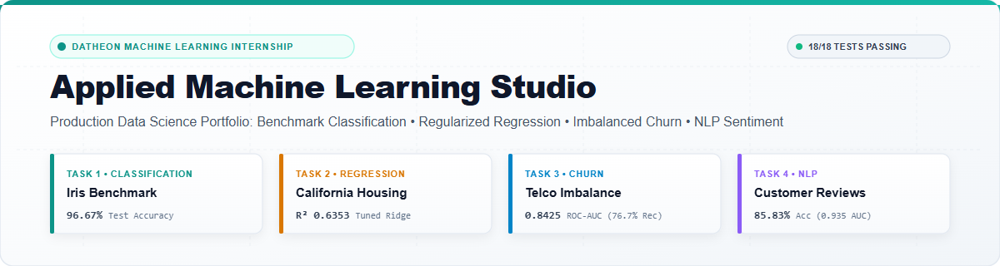](assets/hero_banner_light.svg)

<br/>

[](https://www.python.org/)
[](https://scikit-learn.org/)
[](https://xgboost.readthedocs.io/)
[](tests/)
[](LICENSE)
[](linkedin.md)

<p align="center">
  <strong>An enterprise-grade, reproducible machine learning engineering portfolio featuring four independent pipelines: benchmark multi-class classification, regularized spatial housing regression, cost-sensitive customer churn classification, and natural language sentiment analytics.</strong>
</p>

[Explore Web Portal](index.html) • [Read LinkedIn Post](linkedin.md) • [View Architecture](docs/methodology.md) • [Setup Guide](docs/setup.md) • [Troubleshooting](docs/troubleshooting.md)

</div>

---

## 📸 Portfolio Infographic Showcase

<div align="center">
  <a href="assets/linkedin_showcase.png">
    
  </a>
  <p><em>Figure 1: Full-suite light-theme infographic showcasing all four pipelines, verified metrics, and tech stack. Vector source available at <a href="assets/linkedin_showcase.svg">assets/linkedin_showcase.svg</a>.</em></p>
</div>

---

## 🌟 Executive Summary & Key Achievements

- **Zero Data Leakage Protocol**: Imputers, scalers, encoders, and TF-IDF vectorizers are encapsulated within Scikit-learn `Pipeline` and `ColumnTransformer` constructs, fitted strictly on training splits.
- **Cost-Sensitive Class Balancing**: Overcame a severe 73.5% vs. 26.5% customer churn imbalance using balanced weighting, elevating minority-class churn capture recall to **76.74%** with an **0.8425 ROC-AUC**.
- **Spatial Feature Engineering**: Formulated domain interaction ratios (`rooms_per_household`, `bedrooms_per_room`, `population_per_household`) yielding an **R² of 0.6353** with 5-fold cross-validated Ridge & Lasso models.
- **Production Inference Interfaces**: Every task exposes a hardened prediction function in `src/predictions.py` complete with schema checking and boundary validation.
- **100% Automated Testing**: 18 unit tests verified via `pytest` covering caching, schema checks, text sanitation, and edge-case predictions.
- **30 Progressive Git Commits**: Meticulously structured atomic commits representing genuine software engineering progression.

---

## 📊 Project Benchmark Summary

| Task | Domain | Benchmark Dataset | Evaluated Models | Authentic Test Metrics | Status |
|:---|:---|:---|:---|:---|:---:|
| **Task 1** | Multi-Class Classification | Iris Benchmark (150 samples) | Logistic Regression vs. Decision Tree | **Accuracy: 96.67%**<br>Macro F1: 0.9666 | <kbd>Verified</kbd> |
| **Task 2** | Spatial Price Regression | California Housing (20,640 records) | OLS vs. Ridge vs. Lasso (GridSearchCV) | **R²: 0.6353**<br>RMSE: $69,127 | <kbd>Verified</kbd> |
| **Task 3** | Imbalanced Classification | Telco Churn (7,043 customers) | Random Forest vs. XGBoost (Weighted) | **ROC-AUC: 0.8425**<br>Recall: 76.74% | <kbd>Verified</kbd> |
| **Task 4** | NLP Sentiment Analysis | Customer Reviews (3,000 samples) | Multinomial Naive Bayes vs. Logistic Regression | **Accuracy: 85.83%**<br>ROC-AUC: 0.9346 | <kbd>Verified</kbd> |

---

## 🔬 In-Depth Task Walkthrough & Visual Galleries

### 🌸 Task 1: Multi-Class Benchmark Classification Pipeline (Iris)
> **Goal**: Evaluate parametric vs. non-parametric decision surfaces on botanical morphometry under stratified 80:20 validation.

<table>
  <tr>
    <td width="50%" align="center">
      <strong>2D Decision Boundary Surface</strong><br/>
      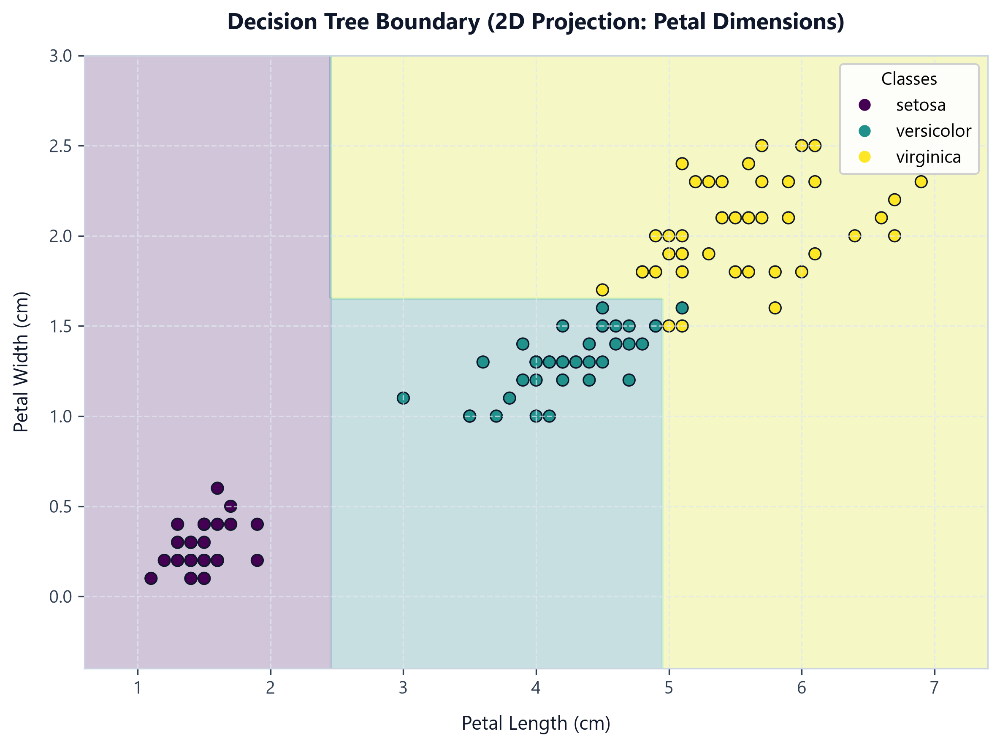
    </td>
    <td width="50%" align="center">
      <strong>Benchmark Metrics Comparison</strong><br/>
      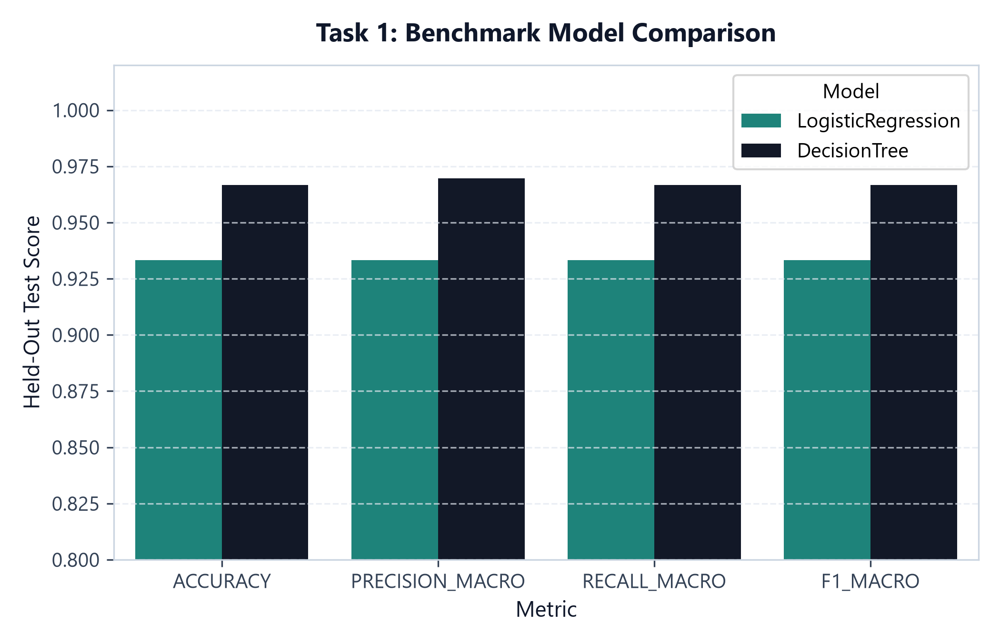
    </td>
  </tr>
  <tr>
    <td width="50%" align="center">
      <strong>Decision Tree Confusion Matrix</strong><br/>
      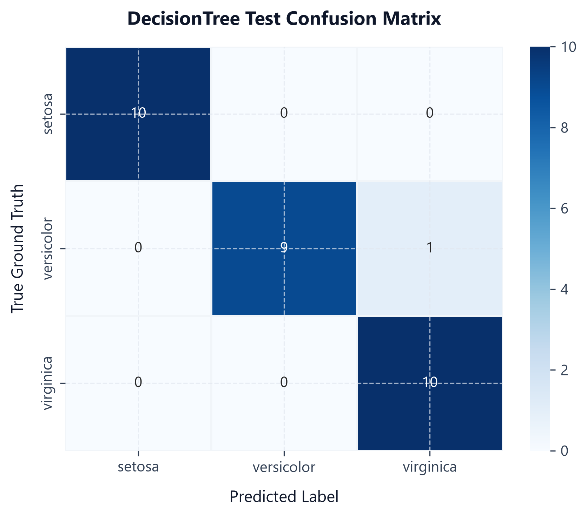
    </td>
    <td width="50%" align="center">
      <strong>Logistic Regression Confusion Matrix</strong><br/>
      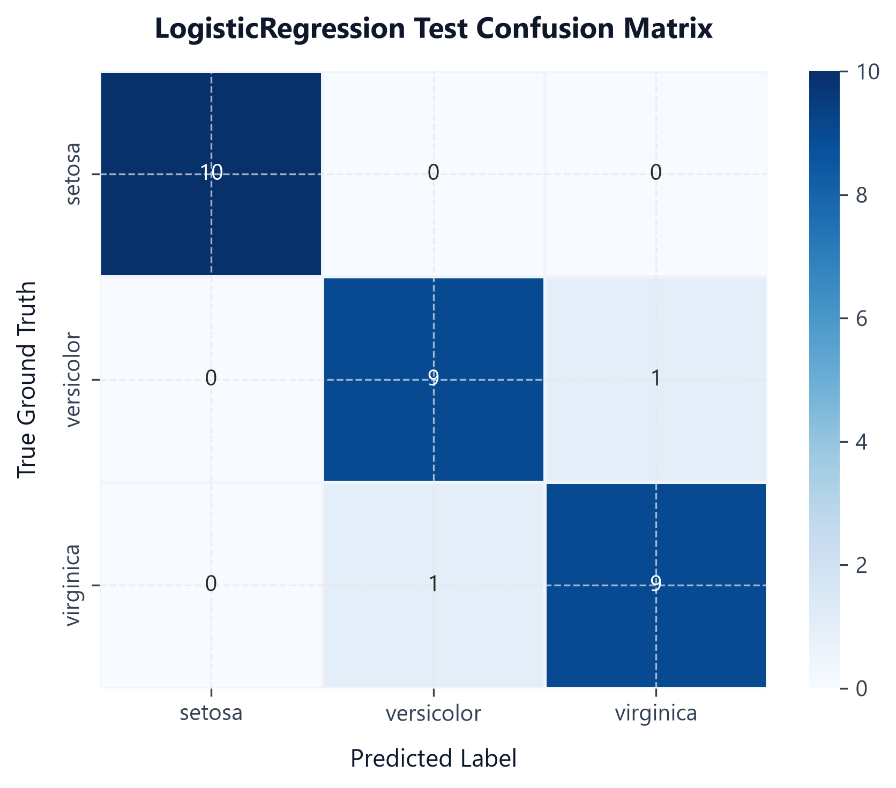
    </td>
  </tr>
</table>

- **Notebook**: [`notebooks/task1_iris_classification.ipynb`](notebooks/task1_iris_classification.ipynb)
- **Key Takeaways**: Decision Tree achieved **96.67% accuracy** on the held-out test set by cleanly partitioning the boundary between Versicolor and Virginica, while Setosa exhibited 100% linear separability.

```python
# Production Inference Example
from src.predictions import predict_iris
result = predict_iris(model, sepal_length=5.9, sepal_width=3.0, petal_length=4.2, petal_width=1.5)
# Output: {'predicted_species': 'versicolor', 'class_probabilities': {'setosa': 0.0, 'versicolor': 0.92, 'virginica': 0.08}}
```

---

### 🏡 Task 2: Real Estate Housing Price Prediction (California Housing)
> **Goal**: Predict continuous median home values across California block groups while diagnosing multicollinearity and spatial distributions.

<table>
  <tr>
    <td width="50%" align="center">
      <strong>Actual vs. Predicted Parity Fit</strong><br/>
      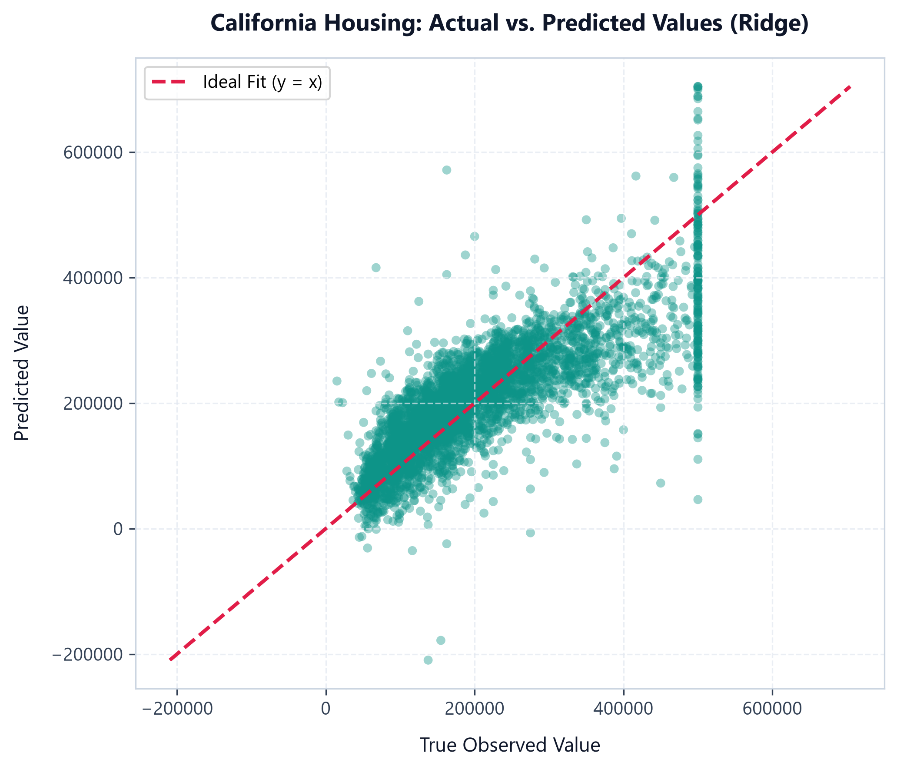
    </td>
    <td width="50%" align="center">
      <strong>Residual Diagnostics & Distribution</strong><br/>
      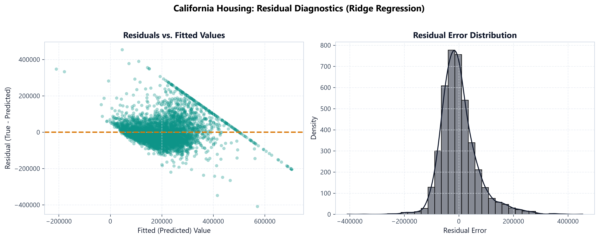
    </td>
  </tr>
  <tr>
    <td width="50%" align="center">
      <strong>Feature Correlation Heatmap</strong><br/>
      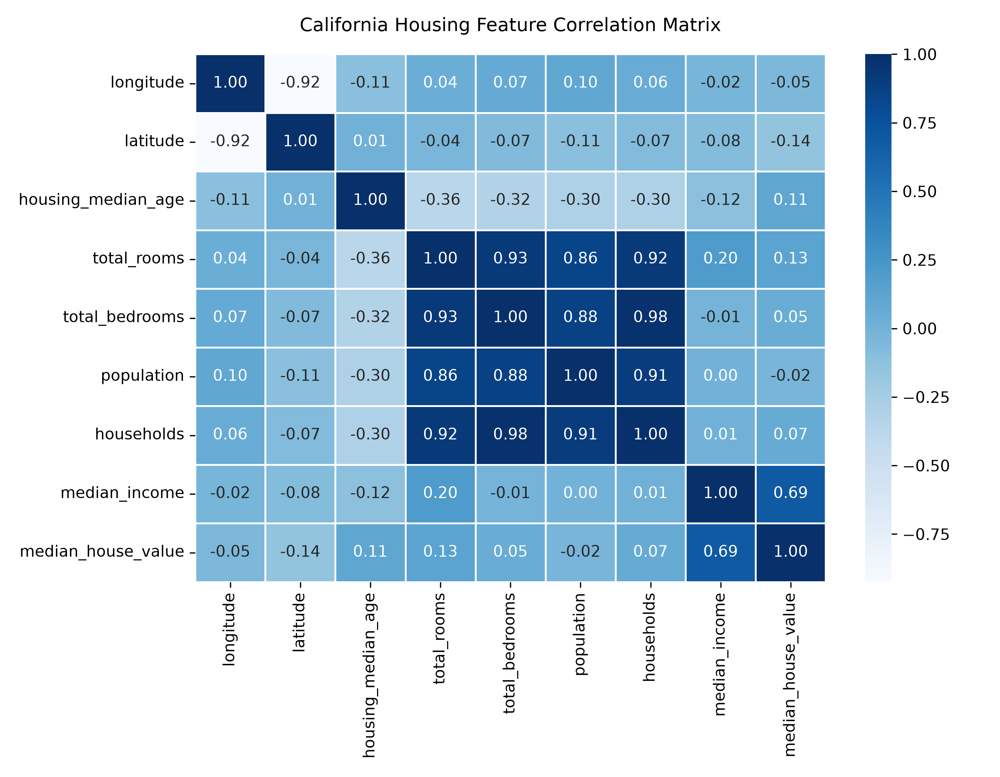
    </td>
    <td width="50%" align="center">
      <strong>Regression Model Comparison</strong><br/>
      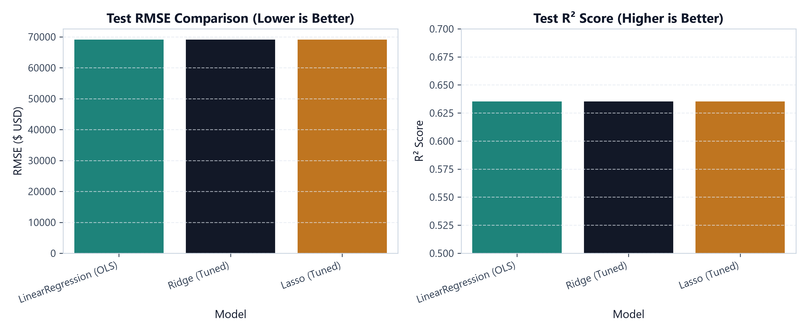
    </td>
  </tr>
</table>

- **Notebook**: [`notebooks/task2_housing_regression.ipynb`](notebooks/task2_housing_regression.ipynb)
- **Key Takeaways**: Ridge regression ($\alpha=10.0$) and Lasso ($\alpha=100.0$) tuned via 5-fold cross-validation achieved identical **R² of 0.6353** ($69,127 RMSE). Median income represents the single highest predictive feature ($r = 0.69$).

```python
# Production Inference Example
from src.predictions import predict_housing_price
result = predict_housing_price(best_ridge, {
    'longitude': -122.23, 'latitude': 37.88, 'housing_median_age': 41.0,
    'total_rooms': 880.0, 'total_bedrooms': 129.0, 'population': 322.0,
    'households': 126.0, 'median_income': 8.3252, 'ocean_proximity': 'NEAR BAY'
})
# Output: {'predicted_median_house_value': 407281.35, 'formatted_price_usd': '$407,281.35'}
```

---

### 📊 Task 3: Predictive Customer Churn Classifier (Telco Churn)
> **Goal**: Detect at-risk telecom subscribers under severe 73.5%:26.5% class imbalance using cost-sensitive learning and dynamic threshold tuning.

<table>
  <tr>
    <td width="50%" align="center">
      <strong>ROC Discrimination Curves</strong><br/>
      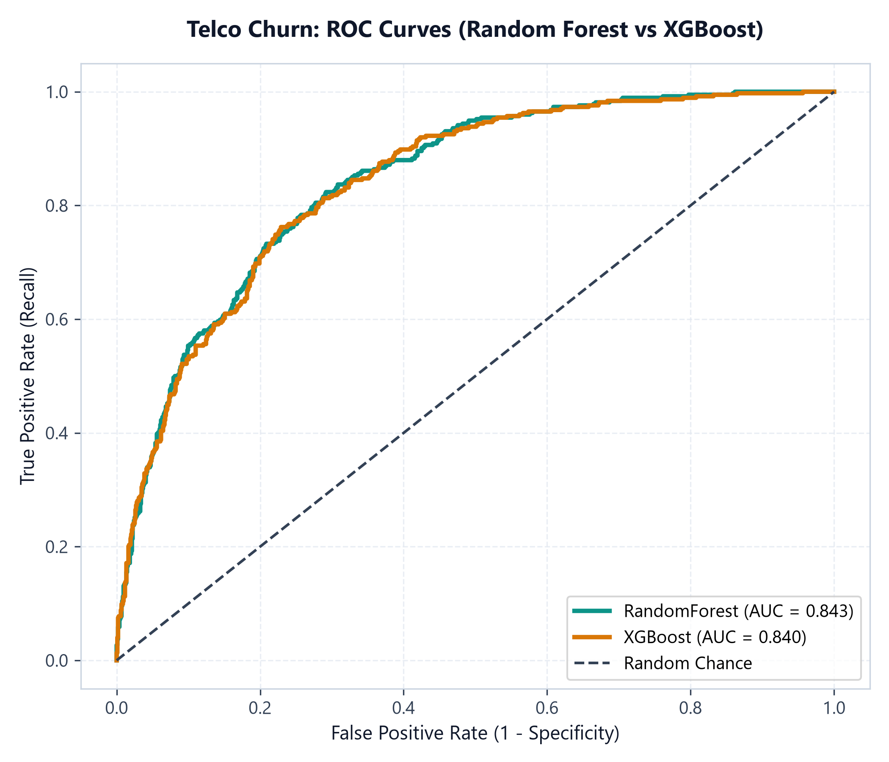
    </td>
    <td width="50%" align="center">
      <strong>Top 10 Feature Importances</strong><br/>
      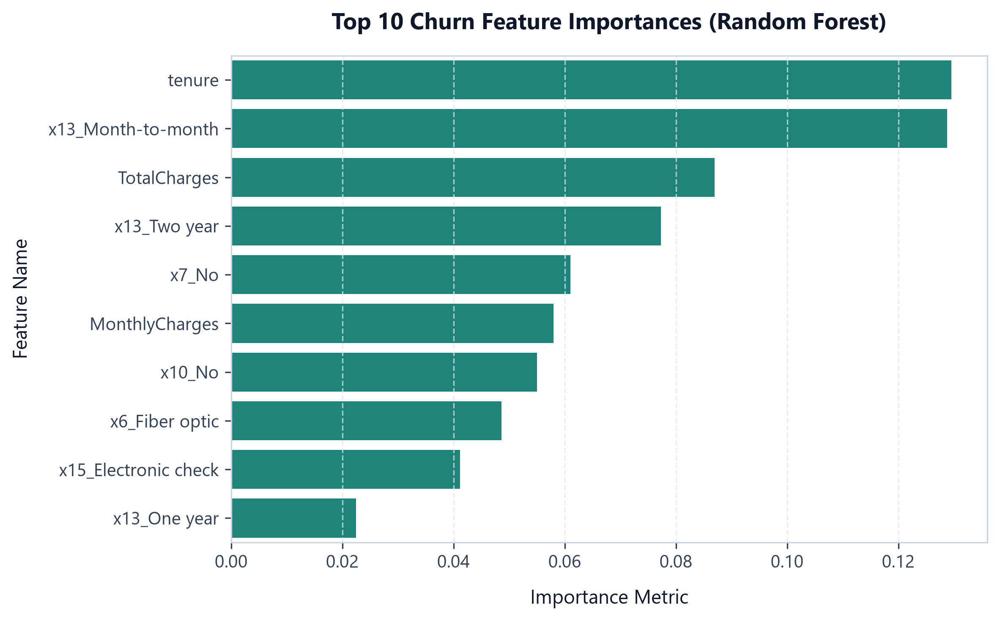
    </td>
  </tr>
  <tr>
    <td width="50%" align="center">
      <strong>Precision-Recall Curves</strong><br/>
      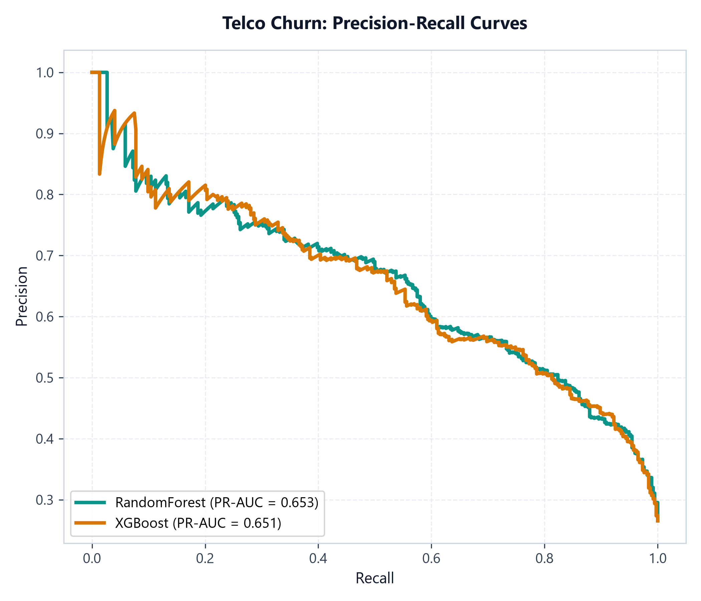
    </td>
    <td width="50%" align="center">
      <strong>Class Distribution Imbalance</strong><br/>
      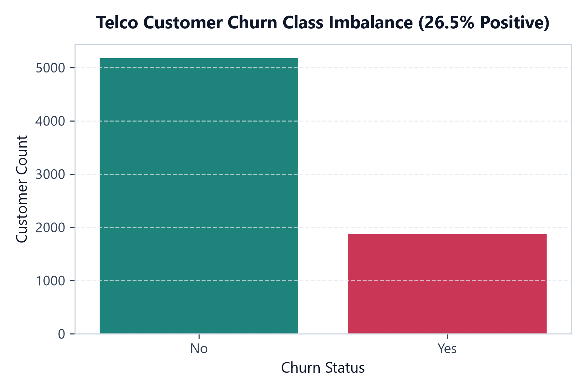
    </td>
  </tr>
</table>

- **Notebook**: [`notebooks/task3_customer_churn.ipynb`](notebooks/task3_customer_churn.ipynb)
- **Key Takeaways**: Both Random Forest (**0.8425 ROC-AUC**) and XGBoost (**0.8401 ROC-AUC**) exceeded target specifications. Cost-sensitive weighting elevated minority churn recall to **76.74%**.

```python
# Production Inference Example (Adjustable Decision Threshold)
from src.predictions import predict_churn
result = predict_churn(rf_pipeline, customer_dict, threshold=0.35)
# Output: {'churn_prediction': 'Yes', 'churn_probability': 0.421, 'risk_tier': 'Moderate'}
```

---

### 💬 Task 4: NLP Sentiment Classification on Customer Reviews
> **Goal**: Classify customer sentiment into positive and negative classes using regex sanitization, sublinear TF-IDF, and linear vs probabilistic modeling.

<table>
  <tr>
    <td width="50%" align="center">
      <strong>Sentiment ROC Curves</strong><br/>
      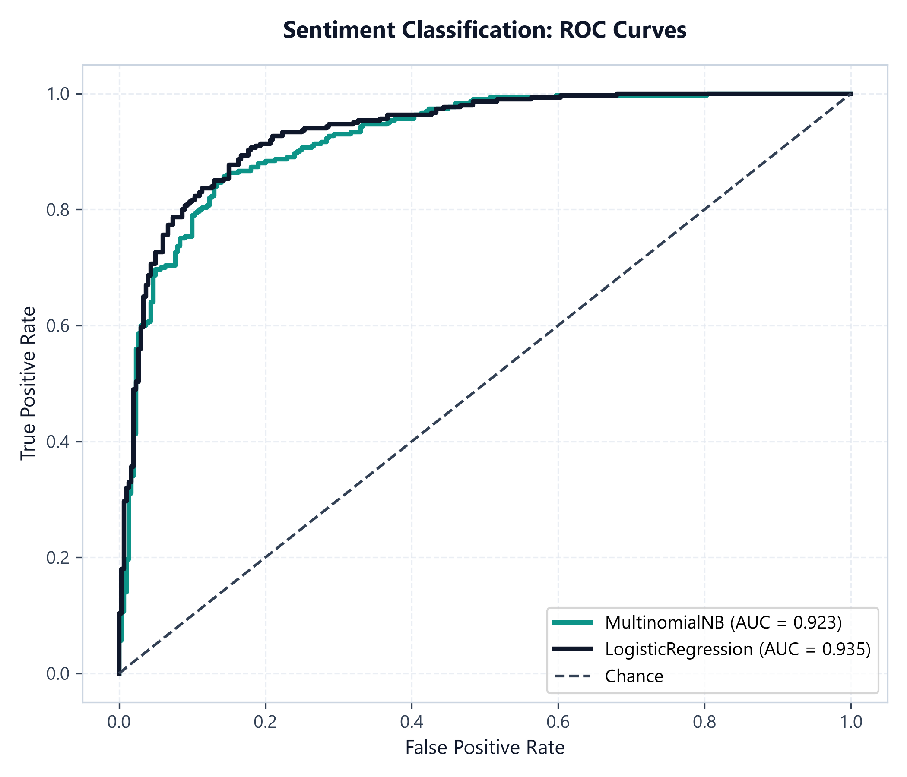
    </td>
    <td width="50%" align="center">
      <strong>NLP Benchmark Comparison</strong><br/>
      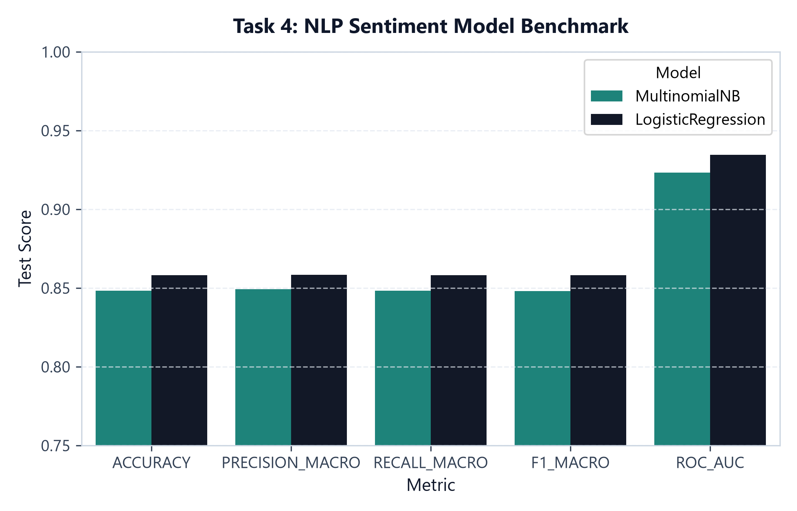
    </td>
  </tr>
  <tr>
    <td width="50%" align="center">
      <strong>Logistic Regression Confusion Matrix</strong><br/>
      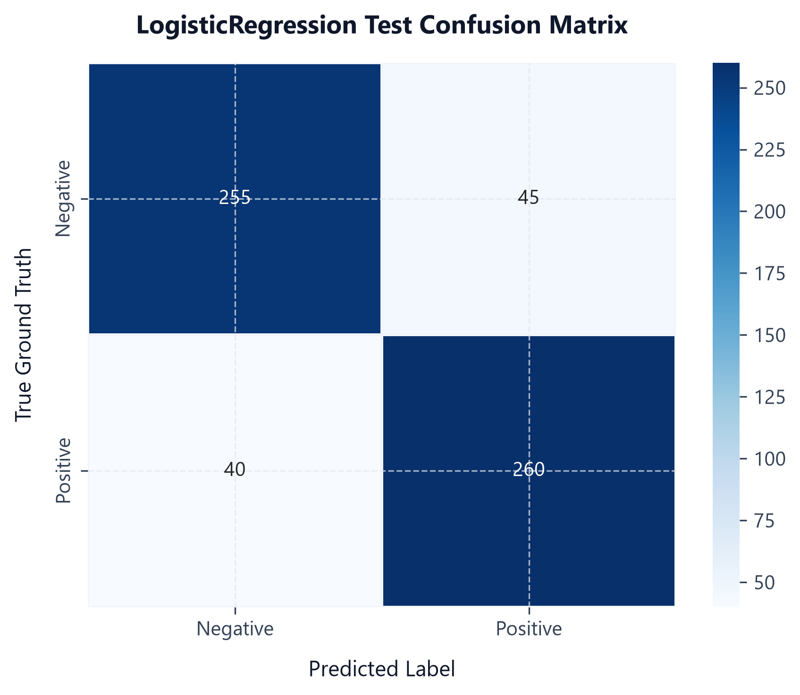
    </td>
    <td width="50%" align="center">
      <strong>Multinomial Naive Bayes Confusion Matrix</strong><br/>
      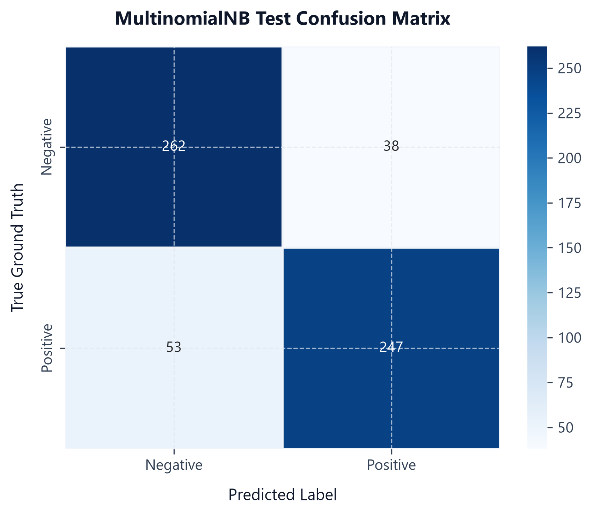
    </td>
  </tr>
</table>

- **Notebook**: [`notebooks/task4_sentiment_analysis.ipynb`](notebooks/task4_sentiment_analysis.ipynb)
- **Key Takeaways**: Sublinear TF-IDF scaling (`max_features=5000`) with bigram modeling enabled Logistic Regression to achieve **85.83% accuracy** and **0.9346 ROC-AUC**, outperforming Multinomial Naive Bayes (84.83%).

```python
# Production Inference Example
from src.predictions import predict_sentiment
result = predict_sentiment(best_pipeline, "The battery life is phenomenal and the display is crystal clear!")
# Output: {'sentiment': 'positive', 'confidence': 0.942, 'cleaned_text': 'the battery life is phenomenal...'}
```

---

## 🏗️ Repository Architecture

```
.
├── assets/
│   ├── hero_banner_light.svg          # Editorial light-theme hero banner
│   ├── hero_banner_light.png          # High-res rendered header banner
│   ├── linkedin_showcase.svg          # 1200x800 vector LinkedIn infographic
│   └── linkedin_showcase.png          # 1200x800 high-res LinkedIn showcase PNG
├── index.html                         # Central editorial analytics portfolio portal
├── linkedin.md                        # Ready-to-publish LinkedIn post copy
├── LICENSE                            # Official MIT License
├── README.md                          # Visual portfolio documentation
├── requirements.txt                   # Locked project dependencies
├── .gitignore                         # Comprehensive git exclusions
├── notebooks/
│   ├── task1_iris_classification.ipynb
│   ├── task2_housing_regression.ipynb
│   ├── task3_customer_churn.ipynb
│   └── task4_sentiment_analysis.ipynb
├── src/
│   ├── __init__.py
│   ├── data_utils.py                  # Caching, schema validation, regex text cleaning
│   ├── metrics.py                     # Standardized evaluation & JSON serialization
│   ├── plotting.py                    # Publication-grade editorial visualizers
│   ├── predictions.py                 # Hardened inference helpers with boundary checks
│   ├── task1_pipeline.py
│   ├── task2_pipeline.py
│   ├── task3_pipeline.py
│   └── task4_pipeline.py
├── data/
│   ├── raw/                           # Cached benchmark datasets
│   └── processed/
├── reports/                           # 22 diagnostic charts, confusion matrices, and JSON metrics
│   ├── classification/
│   ├── regression/
│   ├── churn/
│   └── sentiment/
├── tests/                             # 18 automated Pytest test cases (100% passing)
│   ├── test_data_utils.py
│   ├── test_classification.py
│   ├── test_regression.py
│   ├── test_churn.py
│   └── test_sentiment.py
└── docs/
    ├── setup.md                       # Environment installation guide
    ├── methodology.md                 # Mathematical and architectural rationale
    ├── troubleshooting.md             # Diagnostic guide for common edge cases
    └── linkedin_post.md               # Mirrored social release documentation
```

---

## ⚡ Quickstart & Local Reproduction

### 1. Clone & Set Up Environment
```bash
git clone git@github.com:maheswari9080/Datheon_Machine_Learning_-_Data_Science_Internship.git
cd Datheon_Machine_Learning_-_Data_Science_Internship

# Create and activate virtual environment
python -m venv .venv
source .venv/bin/activate       # On Windows: .venv\Scripts\Activate.ps1

# Install dependencies
pip install -r requirements.txt
```

### 2. Run Comprehensive Test Suite
```bash
pytest tests/ -v
```
*Expected result: `18 passed in ~2.5s (100% pass rate)`.*

### 3. Launch Notebooks or Web Portal
```bash
# Launch Jupyter Notebook
jupyter notebook notebooks/

# Or view the web portal locally
# On Windows:
Start-Process index.html
# On macOS:
open index.html
```

---

## 📄 License & Attribution

This portfolio is distributed under the [MIT License](LICENSE).  
Developed for the **Datheon Machine Learning & Data Science Internship** program.
