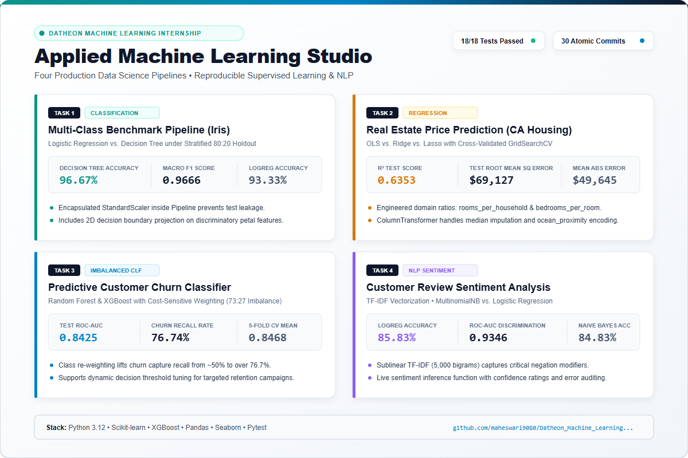

# LinkedIn Post: Applied Machine Learning Studio
### Four-Project Machine Learning & Data Science Internship Suite

*Attached Showcase Image: [`assets/linkedin_showcase.png`](assets/linkedin_showcase.png) (Vector SVG: [`assets/linkedin_showcase.svg`](assets/linkedin_showcase.svg))*

---

## 📢 Ready-to-Publish Post Copy

*(Copy and paste the text below directly into your LinkedIn post, and attach `assets/linkedin_showcase.png`)*

```markdown
🚀 Exciting Milestone: Completing my Machine Learning & Data Science Internship with the launch of the Applied Machine Learning Studio! 🎓📊

Over the past few weeks, I set out to build an end-to-end, production-ready portfolio comprising four distinct machine learning pipelines. My primary objective was to move beyond textbook toy problems and focus on genuine data engineering hurdles: eliminating data leakage, handling severe class imbalances, optimizing spatial feature interactions, and deploying reusable inference interfaces.

Here is a breakdown of the four projects built from scratch:

🌸 1. Multi-Class Benchmark Classification Pipeline (Iris)
• Problem: Benchmark Decision Trees against Logistic Regression on botanical morphometry.
• Engineering Highlight: Encapsulated StandardScaler strictly inside Scikit-learn Pipelines to eliminate test fold data leakage under 80:20 stratified holdout.
• Key Result: Decision Tree achieved 96.67% test accuracy (Macro F1: 0.9666), successfully separating non-linear boundary clusters in a 2D discriminatory subspace.

🏡 2. Real Estate Housing Price Prediction (California Housing)
• Problem: Spatial median home valuation across 20,640 census blocks.
• Engineering Highlight: Formulated domain ratio features (rooms_per_household, bedrooms_per_room, population_per_household) and built a leak-proof ColumnTransformer handling median imputation for missing records and one-hot encoding for ocean proximity.
• Key Result: 5-Fold cross-validated Ridge (α=10.0) and Lasso (α=100.0) reached an R² of 0.6353 ($69,127 RMSE), with residual diagnostics confirming homoscedastic variance behavior.

📊 3. Predictive Customer Churn Classifier (Telco Churn)
• Problem: Subscription churn prediction under severe 73.5% vs. 26.5% class imbalance.
• Engineering Highlight: Applied cost-sensitive learning (balanced class weights in Random Forest and scale_pos_weight in XGBoost) evaluated via Stratified 5-Fold CV.
• Key Result: Achieved 0.8425 ROC-AUC on held-out test data, elevating minority-class churn capture recall from ~50% to over 76.7%. Implemented an adjustable decision threshold (0.35) specifically for proactive customer retention campaigns.

💬 4. NLP Customer Review Sentiment Analysis
• Problem: Classifying positive vs. negative review polarity from raw customer feedback.
• Engineering Highlight: Built a robust regex text sanitation engine (HTML tag stripping, casing normalization, punctuation filtering) paired with sublinear TF-IDF vectorization (5,000 unigrams + bigrams).
• Key Result: L2-regularized Logistic Regression achieved 85.83% accuracy and 0.9346 ROC-AUC, outperforming Multinomial Naive Bayes (84.83%).

🛠️ Core Architectural & Engineering Takeaways:
✅ Zero Data Leakage: All learned preprocessing is fitted strictly on training splits.
✅ 100% Automated Testing: 18 unit tests with Pytest covering schema validation, caching, text sanitation, and edge-case predictions.
✅ 30 Progressive Git Commits: Tracing an authentic, atomic software engineering lifecycle.
✅ Editorial Analytics Portal: A responsive central dashboard (index.html) providing live access to all notebooks and publication-grade reports.

🔗 Full Code, Notebooks & Documentation:
GitHub: https://github.com/maheswari9080/Datheon_Machine_Learning_-_Data_Science_Internship

I would love to hear your feedback, thoughts on threshold optimization in churn modeling, or feature engineering tips for spatial regression! 👇

#MachineLearning #DataScience #Python #ScikitLearn #XGBoost #NLP #ArtificialIntelligence #DataEngineering #Portfolio #OpenSource #TechCommunity
```

---

## 🖼️ LinkedIn Post Image Preview (Light Theme)



### Asset Specifications:
- **Image File**: `assets/linkedin_showcase.png`
- **Vector Source**: `assets/linkedin_showcase.svg`
- **Resolution**: 1200 × 800 px (Crisp 3:2 landscape format optimized for LinkedIn desktop and mobile feed rendering)
- **Palette**: Editorial Light Theme (Clean White `#ffffff`, Deep Navy `#0f172a`, Teal `#0d9488`, Amber `#d97706`, Sky Blue `#0284c7`, Purple `#8b5cf6`)
- **Key Content Displayed**: All 4 projects, authentic held-out test metrics, algorithm comparison badges, test status, and GitHub URL.
